# 🎓 Smart Campus Management System — Database Architecture & Documentation

## 1. Executive Summary

The **Smart Campus Management System** database is an authoritative, highly normalized relational database designed with SQLite (WAL mode enabled, foreign keys enforced) supporting 20 comprehensive campus management modules across 28 interconnected tables. Exactly **1,000 realistic synthetic records** are deterministically generated and verified with **100% integrity and zero broken relationships**.

---

## 2. Entity-Relationship (ER) Architecture

```mermaid
erDiagram
    departments ||--o{ faculty : "employs"
    departments ||--o{ courses : "offers"
    departments ||--o{ students : "enrolls"
    departments ||--o{ subjects : "categorizes"
    departments ||--o{ timetable : "schedules"
    
    users ||--o| faculty : "authenticates"
    users ||--o| students : "authenticates"
    users ||--o{ notices : "authors"
    users ||--o{ leaves : "applies"
    users ||--o{ complaints : "files"
    users ||--o{ feedback : "submits"
    users ||--o{ events : "organizes"
    
    faculty ||--o{ courses : "teaches"
    faculty ||--o{ subjects : "conducts"
    faculty ||--o{ timetable : "scheduled"
    faculty ||--o{ assignments : "assigns"
    faculty ||--o{ feedback : "rated_in"
    
    courses ||--o{ subjects : "contains"
    courses ||--o{ enrollments : "enrolled_in"
    courses ||--o{ attendance : "tracked_for"
    courses ||--o{ exams : "assessed_by"
    courses ||--o{ timetable : "scheduled_in"
    courses ||--o{ assignments : "assigned_in"
    courses ||--o{ feedback : "reviewed_in"
    
    students ||--o{ enrollments : "registers"
    students ||--o{ attendance : "records"
    students ||--o{ results : "achieves"
    students ||--o{ fee_invoices : "billed"
    students ||--o{ fee_payments : "pays"
    students ||--o{ library_issues : "borrows"
    students ||--o| hostel_allocations : "resides_in"
    students ||--o| transport_allocations : "commutes_via"
    students ||--o{ assignment_submissions : "submits"
    students ||--o{ placements : "offered"
    students ||--o{ internships : "interns_at"
    
    exams ||--o{ results : "evaluated_into"
    fee_invoices ||--o{ fee_payments : "settled_by"
    library_books ||--o{ library_issues : "loaned_via"
    hostel_rooms ||--o{ hostel_allocations : "allots"
    transport_routes ||--o{ transport_allocations : "assigned_to"
    assignments ||--o{ assignment_submissions : "turned_in_as"
```



---

## 3. Record Distribution (1,000 Total Records)

| Module # | Table Name | Record Count | Description & Referential Role |
|----------|------------|--------------|--------------------------------|
| 1 | `departments` | 8 | 8 Academic faculties (CSE, ECE, ME, CE, EE, IT, BT, MBA) |
| 2 | `users` | 88 | System authentication: Super Admin, Admins, Faculty, Students, Staff |
| 3 | `faculty` | 20 | Teaching faculty linked to departments and user logins |
| 4 | `courses` | 30 | Degree programs and courses taught by faculty |
| 5 | `students` | 55 | Student master table (Single Source of Truth) |
| 6 | `subjects` | 35 | Academic subjects mapped to courses, departments, and faculty |
| 7 | `enrollments` | 165 | Academic course registrations (3 courses per student) |
| 8 | `attendance` | 155 | Daily attendance entries (Present, Absent, Late) with foreign keys |
| 9 | `exams` | 20 | Midterm, Final, Quiz, and Assignment assessments |
| 10 | `results` | 68 | Academic grades, percentage marks, and grade points (CGPA) |
| 11 | `fee_invoices` | 55 | Semester tuition and laboratory fee invoices |
| 12 | `fee_payments` | 40 | Payment transactions with UPI, NetBanking, and Card details |
| 13 | `timetable` | 25 | Weekly lecture schedules, time slots, and lecture hall locations |
| 14 | `notices` | 12 | Campus bulletins and official circulars |
| 15 | `library_books` | 30 | University catalog with ISBN, author, and availability tracking |
| 16 | `library_issues` | 25 | Book borrow records with issue date, due date, and fine status |
| 17 | `hostel_rooms` | 15 | Campus residential facilities across 3 hostels (AC and Non-AC) |
| 18 | `hostel_allocations` | 20 | Resident student room allocations with foreign key integrity |
| 19 | `transport_routes` | 6 | University bus routes across NCR and regional hubs |
| 20 | `transport_allocations`| 18 | Student bus commuter assignments |
| 21 | `assignments` | 20 | Course homework and laboratory tasks |
| 22 | `assignment_submissions`| 20 | Student turned-in assignment reports and awarded scores |
| 23 | `events` | 10 | Campus techfests, cultural meets, sports leagues, and workshops |
| 24 | `placements` | 15 | Campus recruitment job offers from tier-1 corporations |
| 25 | `internships` | 10 | Industrial summer internships with stipend details |
| 26 | `leaves` | 15 | Formal leave applications and approval workflows |
| 27 | `complaints` | 10 | Campus infrastructure and helpdesk grievance tickets |
| 28 | `feedback` | 10 | Course and faculty evaluation survey responses |
| **TOTAL** | **28 Tables** | **1,000 Records** | **100% Normalized, Relational, and Verified** |

---

## 4. Dynamic Data Synchronization (Single Source of Truth)

### Principle:
Student names, emails, and enrollment numbers are **NEVER hardcoded or duplicated** across dependent tables (`attendance`, `results`, `fee_invoices`, `hostel_allocations`, etc.). All child tables reference `student_id` through a strict foreign key:
```sql
FOREIGN KEY (student_id) REFERENCES students(id) ON DELETE RESTRICT
```

### Propagation Example:
When the administrator executes:
```sql
UPDATE students 
SET full_name = 'Rahul Verma', email = 'rahul.verma@campus.edu'
WHERE enrollment_no = 'CS2025001';
```
Any subsequent relational query retrieves the updated student identity instantly without stale cache or multi-table updates:
```sql
-- Dynamic results query
SELECT s.full_name, s.enrollment_no, e.title, r.marks_obtained, r.grade
FROM results r
JOIN students s ON r.student_id = s.id
JOIN exams e ON r.exam_id = e.id
WHERE s.id = 1;
```
Result: `Rahul Verma` is dynamically rendered across **Student Dashboard, Attendance Portal, Results Sheet, Hostel Ledger, and Admin Console**.

---

## 5. Security & Authentication Model

1. **Role-Based Access Control (RBAC):**
   - `super_admin`: Full database maintenance and role delegation
   - `admin`: Academic, faculty, and student record administration
   - `faculty`: Attendance entry, grade recording, and assignment creation
   - `student`: Profile viewing, attendance check, results, and fee payment
   - `accountant`: Fee invoice generation and payment clearance
   - `librarian`: Book cataloging and issue/return ledger
   - `hostel_warden`: Room allocation and hostel disciplinary management
2. **Password Hashing:**
   - All passwords are encrypted using `bcrypt` (salted SHA-512 derivatives) before persistent storage in the `users` table.
3. **Transaction Safety:**
   - Multi-row operations use `BEGIN TRANSACTION` and `COMMIT` with automatic `ROLLBACK` on constraint violations.

